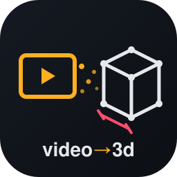
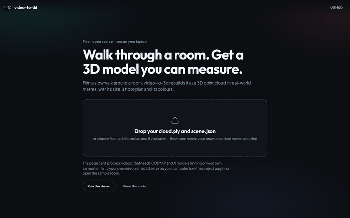
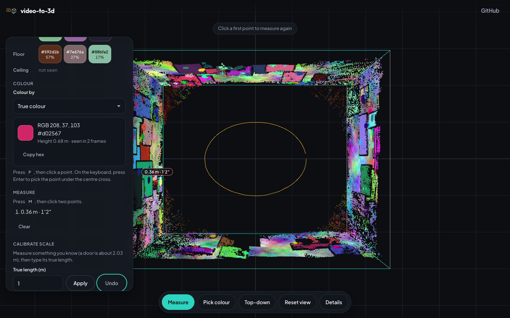
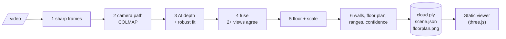

<div align="center">



# video-to-3d

**Walk through a room with your phone. Get a 3D model you can measure, with honest error ranges.**


Free and open source. Runs on a laptop: no LiDAR, no cloud, no API keys.
A phone video becomes a metric point cloud, a room size **with a 90% range and a confidence score**, a floor plan (download as SVG or JSON), the room's colours and a browser viewer.

[Live viewer and demo](https://srijjit-v.github.io/video-to-3d/) · [Run it on your video](#run-it-on-your-video) · [Architecture](#architecture) · [Engineering](#engineering-highlights) · [Verification](#verification-and-limits)

</div>

> [!IMPORTANT]
> **The hosted page can measure a room from a video, but only with a camera-solve server you run yourself.** Everything except the camera path runs **in your browser**:
> it picks sharp frames, runs the AI depth model (19 MB, on WebGPU if you have it, otherwise far slower) and does the measuring. The camera path needs COLMAP, which
> only runs on a server: after a consent screen, ~80 small pictures (never the video) go to the server you choose (`python -m vid3d.sfm_server`), which sends back a small payload and deletes the pictures.
> **No public server exists yet.** Without one, use `vid3d serve` (all on your computer) or the bundled demo.
>
> **Accuracy is only measured on a synthetic room.** Real-phone accuracy has not been measured yet ([protocol](docs/BENCHMARK.md)).
> The error ranges come from a documented model ([docs/MATH.md](docs/MATH.md)), not from real-room statistics.

<p align="center"></p>

<p align="center"></p>

## What it does

Film a slow walk around a room. video-to-3d finds where the phone was, estimates the distance of every pixel, fuses it all into a coloured 3D point cloud, finds the floor and sets the real-world scale,
then measures the room. It tells you **how far to trust the numbers**: "4.0 m (3.8 to 4.2 m), confidence high", or, when a wall was never filmed, "at least 2.7 m, confidence low".

You get a 3D viewer with a ruler, a colour picker, colour-by-height, a calibration tool, the room's palette and a floor plan.
Your video never leaves your computer, and the photos made from it are deleted when the run ends.

## Try it

Open the [live viewer](https://srijjit-v.github.io/video-to-3d/) and press **Run the demo**. Two scans are bundled (about 4 MB together):

| Scan | What it shows | What you should see |
|---|---|---|
| **Good scan** (synthetic 5.0 x 4.0 m room with a door) | the guided demo: size, measure the door, calibrate, top-down, pick a wall colour, colour by height | size about 4.05 x 5.0 m, area range 18.1 to 22.2 m², confidence **high**, door about 2.03 m |
| **Bad capture** (same room, the walk stopped before the far wall) | how the program behaves when the video cannot support a size | "at least 4.05 x 2.73 m", open-ended area range, confidence **low**, a warning that a wall was never filmed |

## Run it on your video

**You need:** Python 3.11 (tested on a MacBook with an Apple M2 chip; other machines are untested), about 2 GB of disk, and internet once for a ~100 MB AI model.

1. **Film.** Walk slowly around the room for 10 to 30 seconds, keep the floor and corners in view, end where you started. `.mp4`, `.mov`, `.m4v`, `.webm`, `.avi`, `.mkv` all work. Limits: 300 s, 4K, 20,000 frames.
2. **Install once.**
   ```bash
   git clone https://github.com/Srijjit-V/video-to-3d.git
   cd video-to-3d
   python3.11 -m venv .venv && .venv/bin/pip install -e .
   ```
3. **Run.** The easy way, drop your video on a page:
   ```bash
   .venv/bin/vid3d serve
   ```
   Or on the command line:
   ```bash
   .venv/bin/vid3d process my_room.mp4     # writes runs/my_room/
   .venv/bin/vid3d view runs/my_room       # opens it in your browser
   ```

Results in `runs/my_room/`: `cloud.ply` (opens in MeshLab, CloudCompare, Blender), `scene.json` (size, ranges, confidence, colours, warnings) and `floorplan.png`.
If you know how high you held the phone, add `--camera-height 1.5`; if the ceiling is in view, `--ceiling-height 2.44`. Both tighten the range.
Reproducible install: `pip install --require-hashes -r requirements/lock-py311.txt`.

| What you see | What it means | What to do |
|---|---|---|
| "The video is only 1.0 seconds long" | too short to work out depth | film at least 3 seconds (10 to 30 is best) |
| "Only 20 of 80 frames could be placed" | the camera path failed for most of the video | walk slower, avoid blank walls, keep detail in view |
| "A wall looks like it was never filmed" | the walk stopped before a wall | walk so every wall appears at some point |
| "Real-world scale is a guess" | no camera or ceiling height given | calibrate on a door in the viewer, or pass `--camera-height` |
| "already exists. Remove it…" | `--out` has an old `frames/` or `work/` folder | choose another `--out`, or delete the folder |

## How it works (in plain words)

Your eyes judge distance because each sees a slightly different picture. A walk-through video is the same trick with hundreds of "eyes" along your path.
It keeps the sharpest ~80 frames, works out where the phone was for each (COLMAP), has an AI guess the distance of every pixel and corrects it with the exact distances COLMAP knows,
merges everything into one cloud (a point survives only if two frames agree), finds the floor, and turns arbitrary units into metres by assuming (or being told) how high the phone was.
The full derivation, with worked numbers, is in [docs/MATH.md](docs/MATH.md).

## Architecture



More diagrams (data flow, upload sequence with progress events, trust boundaries): [docs/ARCHITECTURE.md](docs/ARCHITECTURE.md).

## Engineering highlights

| Concern | Implementation |
|---|---|
| Honest numbers | Monte Carlo over scale error, floor fit and wall detection gives a 90% range per dimension; a 0 to 100 confidence with reasons in words; "at least" ranges when a wall is missing; L-shaped rooms flagged |
| Robust depth | per-frame affine fit `1/z = a d + b`, Theil-Sen start then IRLS with MAD, flying-pixel filter, multi-view voxel agreement |
| Floor and ceiling | lowest dense height layer, RANSAC + SVD re-levelling, interior-fraction ceiling test; 8 adversarial test rooms |
| Privacy | video, frames and COLMAP files deleted when a run ends (success, error, cancel); scene.json stores only the file name; hosted page: frames are picked on the device, nothing is sent without a consent screen that shows the pictures, the server and the size; the video is never sent |
| Untrusted input | duration, resolution and frame-count limits before and during decode; 2 GB upload cap, extension allow-list, server-made file names |
| Local server | `127.0.0.1` only, Host allow-list (DNS rebinding), Origin check, one job at a time, socket timeout, job pruning, traversal tests, CSP |
| Supply chain | model pinned to a commit and loaded as safetensors; three.js bundled with a SHA-384 integrity hash checked against the npm package; hash-pinned lockfile; `pip-audit` in CI |
| Quality gates | ruff (with security rules), mypy, 159 Python tests, 52 Node tests (golden + analytic-room + viewer logic), 16 real-browser tests, GitHub Actions on every push |
| Accessible UI | keyboard-complete, screen-reader labels, tested contrast (23 checks), phone layout verified, strict CSP with no inline script |

## Explore the code

- [`src/vid3d/pipeline.py`](src/vid3d/pipeline.py): the six stages, outputs, warnings
- [`src/vid3d/depth.py`](src/vid3d/depth.py), [`geometry.py`](src/vid3d/geometry.py), [`floorplan.py`](src/vid3d/floorplan.py): the maths
- [`src/vid3d/uncertainty.py`](src/vid3d/uncertainty.py): ranges and confidence
- [`src/vid3d/server.py`](src/vid3d/server.py): the local server and its checks
- [`viewer/`](viewer/): the static viewer; [`DESIGN.md`](DESIGN.md) is its design language
- [`docs/`](docs/): [AUDIT](docs/AUDIT.md) · [MATH](docs/MATH.md) · [ARCHITECTURE](docs/ARCHITECTURE.md) · [SECURITY](docs/SECURITY.md) · [VERIFICATION](docs/VERIFICATION.md) · [BENCHMARK](docs/BENCHMARK.md) · [RESEARCH](docs/RESEARCH.md)

## Local API (`vid3d serve`)

| Method and path | Purpose |
|---|---|
| `POST /api/jobs?camera_height=&ceiling_height=&fov=` | upload a video (`application/octet-stream`); returns `202 {id}`; `409` if a job is running |
| `GET /api/jobs/{id}` | state, six stages with details like "frame 12 of 58", error text, elapsed time |
| `POST /api/jobs/{id}/cancel` | stop the job and delete its private files |
| `GET /jobs/{id}/cloud.ply` · `scene.json` · `floorplan.png` | the three result files (nothing else is served) |
| `GET /api/health` | `{"mode": "local"}`; the static site has no such endpoint, which is how the viewer knows it is hosted |

## Verification and limits

Measured on 2026-11-10 (details in [docs/VERIFICATION.md](docs/VERIFICATION.md)):

- **159** Python tests pass (20 opt-in skipped); **52** Node tests; **16** browser tests; ruff, mypy and `pip-audit` clean.
- Synthetic 5.0 x 4.0 m room: with the true camera height, 4.05 x 5.00 m (+1.3%, 0%) and the area range 18.1 to 22.2 m² contained the true 20 m²;
  with the default 1.45 m assumed, 3.90 x 4.85 m (-2.5%, -3.0%) and the range 13.9 to 24.4 m² contained it too.
- One run per setting; the camera solver varies by a few percent between runs.

**Not claimed:** accuracy on real phone video (not measured); that the 90% ranges are calibrated on real rooms; results for mirrors, glass, moving people or very dark rooms;
non-rectangular rooms beyond flagging them; anything on Windows, Linux or CUDA; Vercel deployment (only GitHub Pages is live; the Vercel connector was refused, see Deploy).

## Hybrid mode (camera path on a server)

Solving the camera path (COLMAP) is the heavy step. In Hybrid mode only the ~80 resized JPEG frames (never the video) go to a small server that runs pycolmap and returns a payload of under 1 MB; depth, fusion and measuring stay on your computer.
The server needs pycolmap, numpy and headless OpenCV only (no torch). It re-encodes every frame (dropping EXIF and GPS), keeps nothing after the job and logs no image content.

```bash
.venv/bin/python -m vid3d.sfm_server --port 8787            # the server (on any machine)
.venv/bin/vid3d process my_room.mp4 --sfm-server http://127.0.0.1:8787
```

**Browser flow (built and tested in Chrome on this computer):** drop a video on the page, open *Advanced options* and enter the server address (default `http://127.0.0.1:8787`; start the server with `--origin` set to the page's address). The page then picks frames, shows a consent screen, sends the pictures, runs AI depth and the measuring on your device (about 2.5 minutes in total for the 6-second synthetic room with a WebGPU laptop, most of it the server's COLMAP), and opens the 3D scene with ranges, confidence and floor-plan export.
Over 5 runs on the synthetic 4.0 x 5.0 m room (true camera height given) the browser path measured the long side 2 to 3% high in four runs and 7% high in one, and the short side 1 to 5% high; the 90% area range contained the true 20 m² in the run that was checked against it. The camera solver varies from run to run.
**Not yet built or tested:** the Docker image in `deploy/`, any public deployment (Modal, Hugging Face Space, Fly), bot protection (Turnstile) and a spend cap, resume after a dropped connection, Safari and phone browsers, real phone video, and a fallback that solves the camera path in the browser (colmap-wasm worked with sequential pairing in the spike but is not wired in). Do not expose the server publicly before those exist.

## Deploy the viewer

The viewer is static. `vercel.json` sets the output folder to `viewer` with no build and a strict CSP; `.github/workflows/pages.yml` publishes the same folder to GitHub Pages (live link above).

```bash
npx vercel login
npx vercel deploy --prod --yes      # run inside this folder
```

Nothing that needs COLMAP or PyTorch runs on the host.

## License and credits

[MIT](LICENSE). Depth Anything V2 **Small** is Apache 2.0; COLMAP is BSD.
Built on [COLMAP / pycolmap](https://colmap.github.io/), [Depth Anything V2](https://github.com/DepthAnything/Depth-Anything-V2), [OpenCV](https://opencv.org/), [three.js](https://threejs.org/), [PyTorch](https://pytorch.org/), [Transformers](https://github.com/huggingface/transformers).
