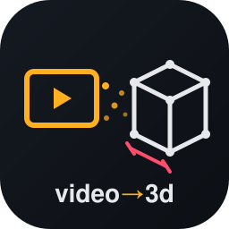

<p align="center">
  
</p>

<h1 align="center">video-to-3d</h1>

<p align="center">
  <b>Walk through a room with your phone. Get a 3D model you can measure.</b><br>
  Free, open source, runs on a laptop. No LiDAR, no cloud, no API keys.
</p>

---

Film a slow walk around a room. `video-to-3d` turns the video into:

- a **3D point cloud** in real-world metres
- a **room estimate**: length × width, height if the ceiling is visible, area in m² and ft²
- a **top-down floor plan** image
- a **local 3D viewer** where you click two points to measure anything, switch to top-down view, and calibrate against a known length (like a door)

Tested on an M2 MacBook Air with 8 GB of RAM. A 90-frame video takes about 3 minutes.

## How it works

```
video ─► sharp frames ─► camera path (COLMAP) ─► AI depth per frame (Depth Anything V2)
      ─► fuse into one cloud ─► find floor & scale ─► line up walls ─► floor plan + viewer
```

| Stage | What happens |
|---|---|
| 1. Frames | Keep the sharpest frame in each slice of the video |
| 2. Camera path | COLMAP works out where the camera was for every frame, matching all frame pairs so the loop closes |
| 3. Depth | AI depth per frame, fitted to COLMAP's exact points so all frames agree |
| 4. Fuse | Merge into one cloud, keeping only points that at least 2 frames agree on |
| 5. Scale | Find the floor; set metres from camera height, ceiling height, or your calibration |
| 6. Floor plan | Line walls up with the axes and measure wall to wall |

When the video can't support a measurement (too few frames placed, opposite walls
not seen), the tool says so rather than printing a wrong number.

## Quick start

```bash
git clone https://github.com/Srijjit-V/video-to-3d.git
cd video-to-3d
python3.11 -m venv .venv
.venv/bin/pip install -e ".[dev]"

.venv/bin/vid3d process my_room.mp4        # writes runs/my_room/
.venv/bin/vid3d view runs/my_room          # opens the viewer at http://127.0.0.1:8765
```

The first run downloads the Depth Anything V2 Small model (~100 MB) from Hugging Face.

**Options for `process`:** `--frames 80` (more = more detail, slower) ·
`--camera-height 1.5` · `--ceiling-height 2.44` · `--fov 70` (~110 for ultra-wide) ·
`--stride 4` (lower = denser cloud)

**Output folder:** `cloud.ply` (also opens in MeshLab, CloudCompare, Blender) ·
`scene.json` (room numbers, warnings, camera path) · `floorplan.png`

## Getting good numbers

**Scale.** A plain video can't tell a room from a scale model, so by default the
tool assumes you held the phone about 1.45 m off the floor (good to roughly ±5–10%).
Tighten it, from best to good:

1. Calibrate in the viewer: measure a door (about 2.03 m) and type its real length.
2. `--ceiling-height 2.44` if the ceiling is visible in the video.
3. `--camera-height 1.5` if you know how high you held the phone.

**Filming.** Walk slowly and turn gradually. Keep the floor and room corners in view.
Walk a loop back to where you started. Blank white walls, mirrors and windows are hard;
good light helps.

## Accuracy

`scripts/make_synthetic_room.py` renders a video of a 5.0 × 4.0 × 2.6 m room with the
camera at 1.5 m. An automated test runs the whole pipeline on it:

| Setting | Result |
|---|---|
| `--camera-height 1.5` (true height) | 4.0 × 5.0 m |
| default (assumes 1.45 m) | 3.85–3.9 × 4.8 m (−3 to −4%, as expected) |

That's a clean synthetic scene; real rooms are noisier. Real-phone results aren't measured yet.

## Roadmap

From [docs/RESEARCH.md](docs/RESEARCH.md), a review of current open-source work:

- [ ] **Real-world scale without guessing**: Depth Anything 3 Metric (Apache 2.0) predicts depth in metres
- [ ] **Faster, sturdier camera path**: Depth Anything 3 Small/Base estimates poses and depth in one pass
- [ ] **Photo-real view**: Gaussian splatting on the Mac (OpenSplat / msplat) from our existing camera path
- [ ] **Doors, windows, L-shaped rooms**: SpatialLM (non-commercial weights, research only)
- [ ] Real-phone accuracy benchmark

## Development

```bash
.venv/bin/python -m pytest -q                                   # unit tests, ~2 s
VID3D_E2E=1 .venv/bin/python -m pytest -q tests/test_e2e.py     # full pipeline accuracy check, ~3 min
.venv/bin/python scripts/make_synthetic_room.py                 # writes samples/synthetic_room.mp4
```

| Path | What's there |
|---|---|
| `src/vid3d/` | Pipeline: `frames`, `sfm`, `depth`, `geometry`, `floorplan`, `pipeline`, `cli` |
| `viewer/index.html` | three.js viewer served by `vid3d view` |
| `scripts/` | Synthetic test-room generator |
| `tests/` | Unit tests plus an opt-in end-to-end test |
| `docs/` | Research notes and the logo |

## Built on

[COLMAP](https://colmap.github.io/) / [pycolmap](https://github.com/colmap/pycolmap) ·
[Depth Anything V2](https://github.com/DepthAnything/Depth-Anything-V2) ·
[OpenCV](https://opencv.org/) · [three.js](https://threejs.org/) ·
[PyTorch](https://pytorch.org/) · [Hugging Face Transformers](https://github.com/huggingface/transformers)
