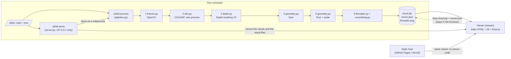
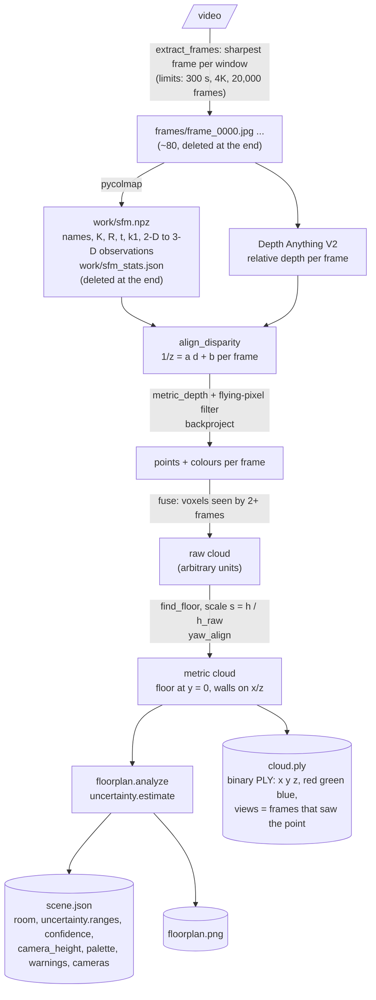
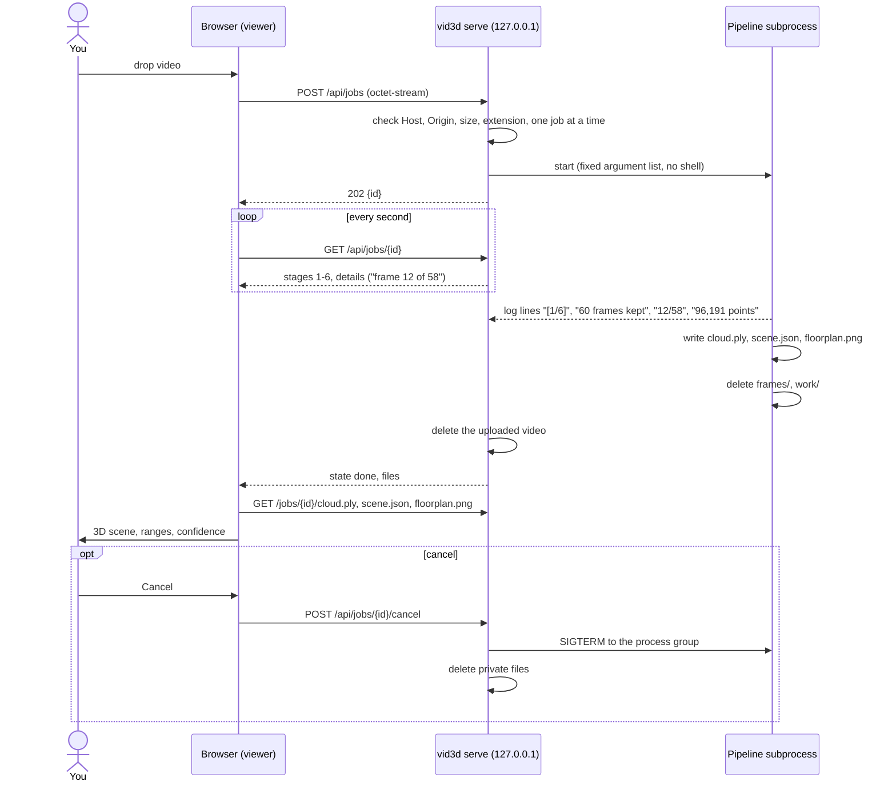
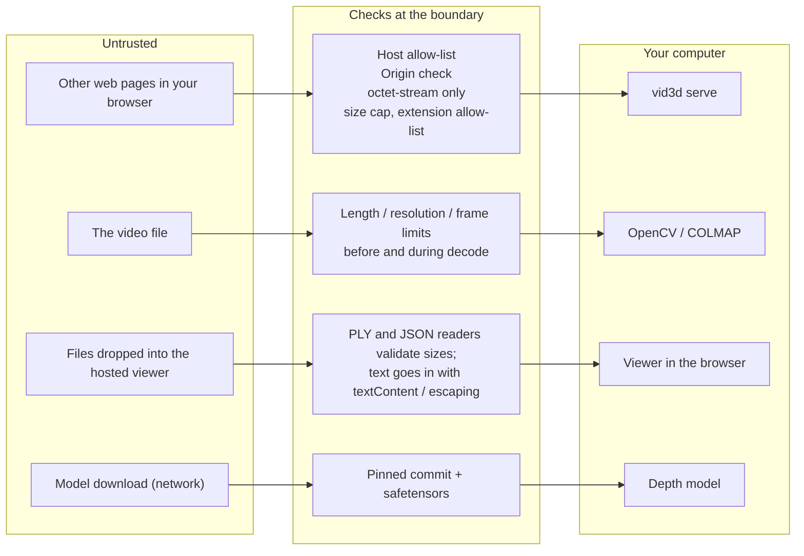
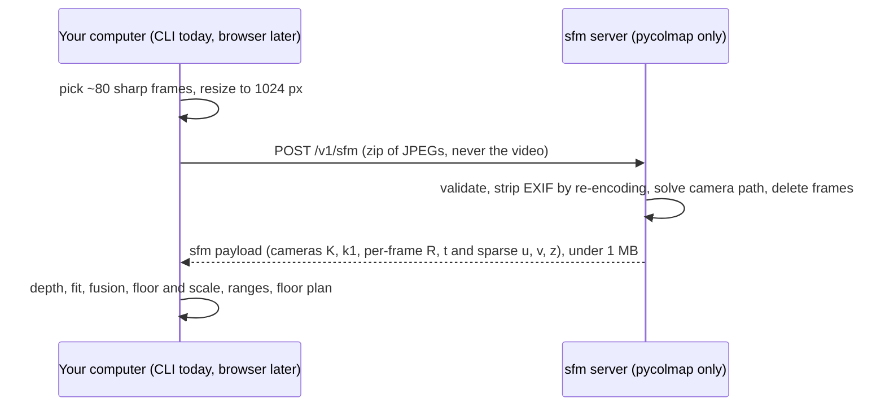

# Architecture

video-to-3d is a pipeline of six stages that turns a phone video into a measurable point cloud, plus a static web viewer.
The pipeline runs on one person's computer. The viewer can run anywhere, because it only reads files.

## 1. System

Why COLMAP runs in its own process: it and PyTorch each load their own OpenMP runtime, and in one process they abort.
A subprocess also gives the camera-solve a clean exit code (3 with an `error:` line when the message is meant for people).

## 2. Data flow and file formats

| File | Format | Holds |
|---|---|---|
| `cloud.ply` | binary little-endian PLY | `x y z` as float32 metres, `red green blue` as uint8, optional `views` as uint8 |
| `scene.json` | JSON | the video **file name** (never a path), scale method, frame counts, `room` (size, `wall_support`, `missing_wall`), `uncertainty` (90% ranges), `confidence`, `camera_height`, `palette`, camera positions, `warnings`. Demo scenes add `demo` with the known truth. |
| `floorplan.png` | PNG | top-down view with the room box and camera path |
| `work/sfm.npz` | NumPy archive | camera poses and intrinsics, per-frame 3-D to 2-D matches. Deleted after the run. |

## 3. Upload to result (local mode)

The progress the viewer shows is parsed from the lines the pipeline really prints, so it cannot get ahead of the work.

## 4. Trust boundaries

Details and the threat model are in [SECURITY.md](SECURITY.md).

## Hybrid mode: the seam

In the browser the same seam is used: the page does stages 1, 3, 4, 5 and 6 on the device (frame picking on the main thread, AI depth on WebGPU or WASM, fusion to ranges in a worker) and only stage 2 (COLMAP) on the server. `ts/src` is a port of `src/vid3d` checked against it by golden vectors.

The payload format is documented in `src/vid3d/sfm_payload.py` and validated on both sides. Local mode (`vid3d process`) writes the same data to `work/sfm.npz`; any solver that produces the payload (the server, colmap-wasm) plugs in at the same point.

## Modules

| Module | Job |
|---|---|
| `frames.py` | sharpest frame per window, with duration, resolution and frame-count limits |
| `sfm.py` | COLMAP camera path in a separate process |
| `depth.py` | Depth Anything V2 and the robust fit to COLMAP's depths |
| `geometry.py` | back-projection, voxel fusion, RANSAC, floor and ceiling finding |
| `floorplan.py` | wall alignment, room extent, wall support, floor-plan image, palette |
| `uncertainty.py` | Monte Carlo ranges, confidence, camera-height consistency |
| `color.py` | exposure normalisation, dominant colours |
| `sfm_payload.py`, `sfm_server.py`, `sfm_client.py` | the camera-solve seam, the Hybrid server and its client |
| `privacy.py` | deleting the frames and work files |
| `pipeline.py` | runs the stages, writes the outputs, quality warnings |
| `server.py`, `cli.py` | local servers and the command line |

The maths of stages 3 to 6 is in [MATH.md](MATH.md).
