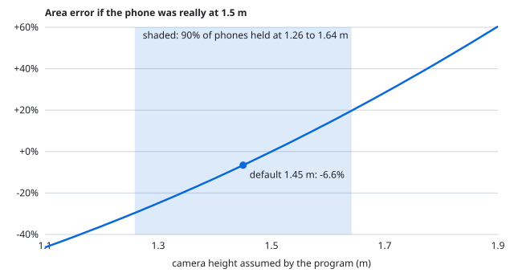
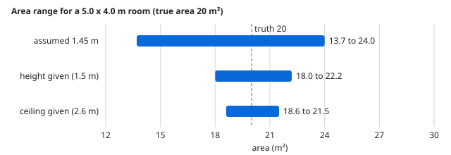

# The maths, from the code

Every formula below is the one the code uses, with the file and function that holds it. Every worked number is printed by
[`scripts/math_examples.py`](../scripts/math_examples.py) (run it to check). Nothing here is a claim about real phone footage;
it describes what the program does to its input.

Contents: [1 Back-projection](#1-pixels-to-3d-points) · [2 Depth fit](#2-the-ai-depth-fit) · [3 Flying pixels](#3-flying-pixels) ·
[4 Fusion](#4-fusing-frames-into-one-cloud) · [5 Planes](#5-ransac-planes) · [6 Floor](#6-finding-the-floor) · [7 Ceiling](#7-ceiling-test) ·
[8 Walls](#8-straightening-the-walls) · [9 Scale](#9-real-world-scale) · [10 Ranges](#10-how-wrong-could-it-be) · [11 Confidence](#11-confidence-score)

## 1. Pixels to 3D points

`geometry.backproject`. A pixel $(u, v)$ in a frame with intrinsics $K$ and a depth $z$ (distance along the optical axis) becomes

$$
\begin{pmatrix} x_d \\ y_d \\ 1 \end{pmatrix} = K^{-1} \begin{pmatrix} u + 0.5 \\ v + 0.5 \\ 1 \end{pmatrix},
\qquad
X_c = z \begin{pmatrix} x_u \\ y_u \\ 1 \end{pmatrix},
\qquad
X_w = R^{\top}\,(X_c - t)
$$

where $(R, t)$ is COLMAP's world-to-camera pose, so the camera centre is $-R^{\top}t$. The $+0.5$ makes the pixel's centre the sample point.

**Lens distortion.** COLMAP's `SIMPLE_RADIAL` camera says the distorted coordinate is $x_d = x_u\,(1 + k_1 r_u^2)$ with $r_u^2 = \lVert x_u \rVert^2$.
We have $x_d$ and want $x_u$, which has no closed form, so `undistort_radial` iterates the fixed point

$$ x_u^{(0)} = x_d, \qquad x_u^{(n+1)} = \frac{x_d}{1 + k_1\,\lVert x_u^{(n)} \rVert^2} $$

six times. It converges fast because $k_1 r^2$ is small (a few percent at the image edge).

**Worked example.** $K$ with focal length 500 px and centre $(320, 240)$; pixel $(400, 300)$; $k_1 = -0.1$; depth 2.0 m.
$x_d = ((400.5-320)/500,\ (300.5-240)/500) = (0.1610,\ 0.1210)$.

| iteration | $x_u$ | $r_u^2$ |
|---|---|---|
| 1 | (0.161656, 0.121493) | 0.040893 |
| 2 | (0.161661, 0.121497) | 0.040896 |
| 3 to 6 | (0.161661, 0.121497) | 0.040896 |

Check: $x_u (1 + k_1 r_u^2)$ gives back $(0.1610, 0.1210)$, error $2\times10^{-16}$. Then $X_c = 2.0 \times (0.1617, 0.1215, 1) = (0.3233,\ 0.2430,\ 2.0)$ m.
Without the correction the point would sit at $(0.322, 0.242, 2.0)$: about 1 mm off here, more toward the corners.

## 2. The AI depth fit

`depth.align_disparity`. Depth Anything V2 returns a *relative inverse depth* ("disparity") $d$ for every pixel: larger means closer, but the
numbers have no units. COLMAP gives a handful of true depths $z_i$ per frame (the sparse points it matched at pixels $i$).
Inverse depth of a pinhole camera is affine in the model's output, so we fit, per frame,

$$ \frac{1}{z_i} \approx a\,d_i + b, \qquad a > 0 $$

and then the depth of *every* pixel is $z = 1/(a d + b)$ (`depth.metric_depth`). The fit must survive wrong matches, so it is done in three steps:

1. **Theil-Sen start.** Take 2000 random pairs $(i, j)$ and compute the slope $\dfrac{1/z_i - 1/z_j}{d_i - d_j}$. The median is $a_0$, then $b_0 = \operatorname{median}(1/z_i - a_0 d_i)$.
   A few outliers cannot move a median.
2. **Inlier set.** Residual $r_i = |a d_i + b - 1/z_i|$. Keep $r_i < 3 \times 1.4826 \times \operatorname{median}(r)$. The factor 1.4826 turns the median absolute deviation (MAD) into a standard deviation for Gaussian noise, so this is "keep within 3 sigma".
3. **IRLS.** Three rounds of: least squares on the inliers, recompute residuals, recompute the MAD on the inliers, update the inlier set.
   The frame is dropped if fewer than 15 inliers remain or $a \le 0$.

**Worked example.** 300 samples from $a = 0.8,\ b = 0.05$ with 1% noise, plus 45 samples (15%) whose depth is wrong by a factor 1.5 to 3:

| method | $a$ | $b$ |
|---|---|---|
| truth | 0.8000 | 0.0500 |
| this fit | 0.7995 | 0.0511 |
| plain least squares | 0.7377 | 0.0442 |

At disparity 0.4 the fit gives $z = 2.696$ m (truth 2.703 m). Plain least squares is off by 8% in slope because the outliers drag it.

## 3. Flying pixels

`depth.metric_depth`. Depth maps smear across object edges: a pixel between a near and a far surface gets a depth in between that belongs to neither.
Where the depth changes sharply from one pixel to the next the value is unreliable, so a pixel is set to NaN when

$$ \frac{\lVert \nabla z \rVert}{z} \ge 0.04, \qquad \nabla z = (\partial_x z,\ \partial_y z) \text{ by central differences} $$

Also removed: depths outside $[\,0.5 \min z_i,\ 2.0 \cdot P_{98}(z_i)\,]$ (the range COLMAP saw, with slack) and any pixel where $a d + b \le 10^{-6}$.

**Worked example.** A step from 2.0 m to 2.4 m between neighbouring pixels. Central difference at the two columns beside the step is 0.2 m per pixel, divided by the depth:
0.100 and 0.083, both above 0.04, so both are dropped. A real slanted wall changes by about 0.5% per pixel and stays.

## 4. Fusing frames into one cloud

`geometry.fuse`. All frames' points go into one grid of cubes (voxels) of side

$$ v = \frac{\operatorname{median}(z_{\text{COLMAP}})}{200} $$

so the grid follows the scene's scale: 0.6 cm for a median depth of 1.2 m, 1.5 cm for 3.0 m. Per voxel the position and colour are averaged.
A voxel is **kept only if at least two different frames contributed**:

$$ \text{keep} \iff \bigl|\{\text{frame ids in the voxel}\}\bigr| \ge 2 $$

A random depth error in one frame lands in a voxel nobody else visits and disappears. The number of frames that agreed is saved in `cloud.ply` as the
`views` property (the viewer's "Colour by: views" mode).

## 5. RANSAC planes

`geometry.ransac_plane`. To find a plane $n \cdot x + d = 0$ in noisy points: 400 times, pick 3 random points, form $n = (b - a) \times (c - a)$ normalised,
and count points within a distance threshold. Keep the best. If a fraction $w$ of the points belong to the plane, one triple is all-inlier with probability $w^3$, so

$$ P(\text{at least one clean triple in } 400) = 1 - (1 - w^3)^{400} $$

which is 0.99998 even when only 30% of the points are on the plane. Then the plane is **refined**: take the inliers, centre them at their mean $c$, and the normal is the singular vector of
$(x_i - c)$ with the smallest singular value (SVD), $d = -n \cdot c$. That is the least-squares plane through the inliers.

**Worked example.** 2000 points on the plane $y = 0$ (1 cm noise) plus 1000 points scattered through the room: recovered normal $(0, -1, 0.0002)$, offset $-0.0004$ m, 2011 inliers.

## 6. Finding the floor

`geometry.find_floor`. The biggest plane is not always the floor (it can tilt to include the bottoms of walls), so:

1. Take the "up" direction from the camera poses, $u_0$. Heights $h = p \cdot u$.
2. Histogram the heights of points below the cameras in bins of $\text{bin} = (P_{99}(h) - P_{1}(h)) / 150$ (2 cm for a 3 m span), smooth with the kernel $(0.25, 0.5, 0.25)$, and find peaks of at least 30% of the tallest bin.
   Peaks are horizontal layers: floor, tabletops, sofa seats.
3. The **lowest** layer is the floor. Fit a plane to just the points within 3 bins of it (section 5, normal within 15 degrees of $u$), which gives a new $u$.
4. Repeat from step 2 with the new $u$, up to 4 times, until the direction moves less than 0.2 degrees. This re-levels the whole cloud.
5. Camera height in reconstruction units: $h_{\text{raw}} = \operatorname{median}_k (c_k \cdot u + d)$ over all camera centres $c_k$.

Sofa tops, tabletops and a dense stripe on a wall are all layers, but only the lowest one is the floor. `tests/test_geometry.py` tries eight adversarial rooms on this.

## 7. Ceiling test

`geometry._interior_fraction`. The highest dense layer above the cameras is a ceiling candidate at height $t$. It is accepted only when all hold:

- $t > 1.2\,h_{\text{raw}}$ (a ceiling is higher than a held phone),
- the layer has more than 10% as many points as the floor layer,
- **at least 30% of its points lie in the middle of the room.** For a point $p$ with horizontal distance $\rho(p)$ from the cameras' centre, a point counts as interior when $\rho(p) < 0.6 \cdot \operatorname{median}\rho(\text{wall points})$.

Why the last test: a ceiling covers the room from wall to wall, so a large share is in the middle. A band of wall texture at one height has all its points on the walls, none in the middle.

## 8. Straightening the walls

`floorplan.dominant_yaw`. Walls should run along the x and z axes. Rotate the top-down wall points (heights 0.3 m to just under the ceiling) by $\theta$ and score

$$ S(\theta) = \sum_{k \in \{x, z\}} \sum_{\text{bins } j} N_{kj}(\theta)^2 $$

where $N_{kj}$ is the number of points in 2.5 cm bin $j$ along axis $k$. When walls are aligned their points pile into a few bins, which makes the sum of squared counts large (a sum of squares is largest when mass is concentrated). The angle is searched in 1 degree steps over 0 to 90, then in 0.1 degree steps around the best.

**Room extent.** `floorplan._extent`. In each axis, histogram the points in 5 cm bins and call a bin a wall when it holds at least $\phi = 30\%$ of the fullest bin.
The room spans from the first to the last wall bin. If that span is less than half of the 1st to 99th percentile spread (the strong bins all sat on one wall), the trimmed spread is used instead.
The threshold $\phi$ is a free choice, which is why it is varied in section 10.

## 9. Real-world scale

Everything up to here is in arbitrary reconstruction units. One number converts to metres:

$$ s = \frac{h}{h_{\text{raw}}} \qquad\text{(camera height known or assumed)} \qquad\text{or}\qquad s = \frac{H}{H_{\text{raw}}} \quad\text{(ceiling height known)} $$

with $h = 1.45$ m by default. Every length is multiplied by $s$, every area by $s^2$.

**Worked example.** Fitted $h_{\text{raw}} = 0.62$ units, walls measured $2.10 \times 1.70$ units. $s = 1.45/0.62 = 2.3387$. Room $= 4.91 \times 3.98$ m, area 19.53 m².

**Error propagation.** Suppose the true camera height is $h_{\text{true}}$ but we used $h$. Then the measured length is $L_{\text{meas}} = (h / h_{\text{true}})\, L$, and the area

$$ A_{\text{meas}} = L_{\text{meas}} W_{\text{meas}} = \left(\frac{h}{h_{\text{true}}}\right)^{2} A \qquad\Rightarrow\qquad \frac{\delta A}{A} \approx 2\,\frac{\delta s}{s} $$

because one scale multiplies both sides. A phone really held at 1.60 m while 1.45 m is assumed gives lengths $-9.4\%$ and area $-17.9\%$. To keep the area within 5% the height must be right within about $\pm 2.5\%$ (1.46 to 1.54 m when the truth is 1.5 m).

## 10. How wrong could it be?

`uncertainty.estimate`. Three things are uncertain, and they are drawn at random 400 times (Monte Carlo) rather than combined with a formula,
because wall detection is not smooth:

| Source | Model | Size |
|---|---|---|
| Camera height (the scale source) | multiplicative error $1+\varepsilon_h$, $\varepsilon_h \sim \mathcal N(0, \sigma_h)$ | $\sigma_h$ = 0.08 if assumed, 0.03 if given, 0.02 if the ceiling is given |
| Floor fit, $h_{\text{raw}}$ | the floor is re-fitted on 12 random halves of the cloud; relative standard deviation of $h_{\text{raw}}$ | measured per scene, $\sigma_f$ (about 0.01 on clean data) |
| Wall positions | bootstrap resample of the wall points, wall threshold $\phi \sim U(0.15, 0.45)$ | measured per scene |

Per draw $i$, with the same scale error applied to every length (they share one scale):

$$ f_i = \frac{1 + \varepsilon_h}{1 + \varepsilon_f}, \qquad L_i = f_i\,L^{\text{walls}}_i, \quad W_i = f_i\,W^{\text{walls}}_i, \quad A_i = L_i W_i $$

and the reported range is the 5th to 95th percentile of the 400 values (a 90% interval). Reading: "we expect the true value to lie in this range about 9 times out of 10, if the room is a rectangle and our error model is right."

Where $\sigma_h = 0.08$ comes from: a phone held for a walkthrough sits between chest and eye level, 1.2 to 1.7 m, which is $\pm 17\%$ around 1.45 m.
Treating that as two standard deviations gives $\sigma_h \approx 0.08$. It is a judgement, not a measurement on real footage: that is stated in [docs/VERIFICATION.md](VERIFICATION.md).

**Worked example** (5.0 x 4.0 m room, true area 20 m², clean synthetic cloud):

| Scale source | Length range | Area range | $\sigma$ used |
|---|---|---|---|
| assumed 1.45 m (phone really at 1.5 m) | 4.13 to 5.47 m (central 4.8) | 13.7 to 24.0 m² (central 18.48) | 0.081 |
| camera height given, 1.5 m | 4.74 to 5.26 m (central 5.0) | 18.0 to 22.2 m² | 0.032 |
| ceiling given, 2.6 m | 4.82 to 5.19 m (central 5.0) | 18.6 to 21.5 m² | 0.022 |

The area range is roughly twice as wide, relatively, as the length range, as section 9 predicts. A test asserts the ratio is between 1.7 and 2.3
and that the range contains the truth for phones held at 1.3, 1.45, 1.5 and 1.6 m while 1.45 m is assumed.

**Camera-height consistency.** The model has one scale. If the phone really rose and fell during the walk, one scale cannot fit everywhere. `uncertainty.camera_height_consistency`
computes the standard deviation of all camera heights above the floor divided by their median, and flags it above 0.15.

**What the range does not include:** a wrong floor (a rug, a sofa taken for the floor), a non-rectangular room (flagged separately, section 11),
motion in the room, glass, mirrors, and systematic bias of the depth model on real rooms.

## 11. Confidence score

`uncertainty.confidence`. A 0 to 100 score for people, with the reasons in words. Start at 100 and subtract:

| Condition | Points |
|---|---|
| scale assumed / given by camera height / given by ceiling | 25 / 10 / 5 |
| share of placed frames below 80% | up to 25 (1 point per percentage point below 80) |
| outline not a rectangle (wall support below 0.88) | 20 |
| area range half-width above 25% / above 15% | 30 / 15 |
| phone height inconsistent | 10 |
| room not measurable (opposite walls missing) | capped at 20 |

A score of 75 or more is **high**, 50 to 74 **medium**, below 50 **low**. The weights are judgement, chosen so the three samples order sensibly
(good, default-scale, bad capture); they have not been calibrated against real measurements.

**Non-rectangular rooms.** `floorplan.wall_support`: cut the four sides of the bounding rectangle into 10 cm pieces; a piece counts if a wall point lies within 25 cm. The score is the mean over the four sides.
A box scores near 1 (a doorway costs a little); an L-shaped room's two missing sides give about 0.75. Below 0.88 the room is flagged and its area is called an upper bound.
